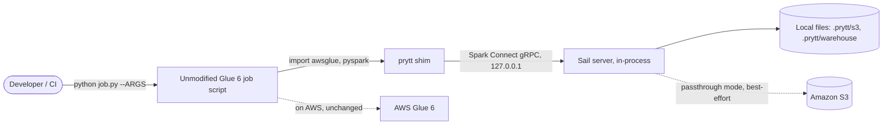
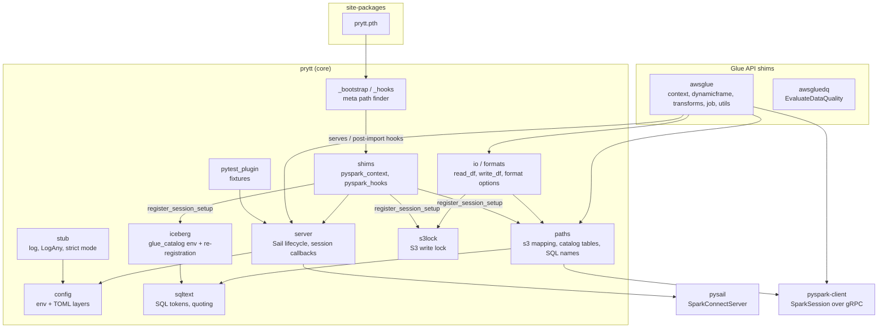
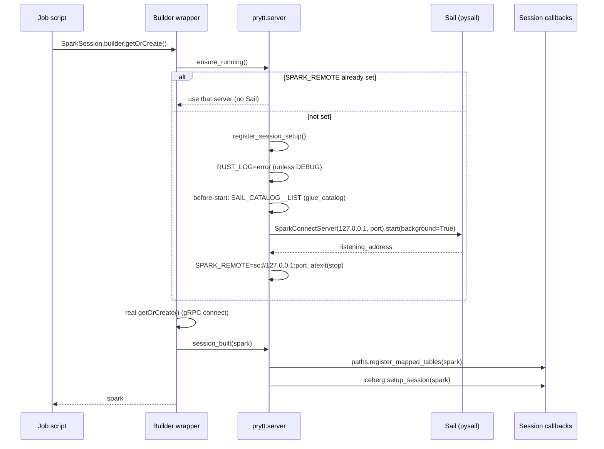
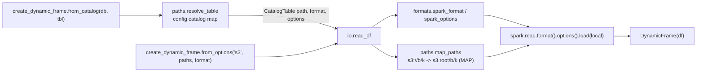

# Solution architecture

This document describes how prytt is built and why: its context, components,
runtime behaviour, data layout, deployment shapes, the decisions behind them,
and the risks. Decisions with real alternatives are recorded as ADRs in
[`docs/adr/`](../adr/). Terms such as *mapped table* and *registered table*
are defined in [`GLOSSARY.md`](../../GLOSSARY.md).

## Context

AWS Glue jobs are PySpark scripts that import Glue's `awsglue` library and
run on a managed Spark cluster. Developing them usually means deploying to
AWS for every change, or running AWS's Glue Docker image (a JVM, Spark and
the Glue libraries, several GB). Both make the edit-run loop slow.

prytt makes the same script run locally, in seconds, in a plain Python
virtual environment:



### Goals

- **No script changes.** A script that runs on Glue 6 runs locally as is,
  including the boilerplate (`SparkContext()`, `GlueContext(sc)`,
  `Job.init`, `sc._jsc...`).
- **No JVM, no Docker.** One `uv add --dev`, pure Python plus a Rust wheel.
- **Fast.** < 1 ms added to every interpreter start; < 1 s to a usable
  session once Sail is warm.
- **Honest.** Every place local behaviour differs from Glue is logged (`MAP`,
  `WARN`, `STUB`), and strict mode turns gaps into errors for CI.

### Non-goals

- Emulating Glue's control plane: bookmarks, workflows, crawlers,
  connections, the Data Catalog API, Lake Formation.
- Performance parity or DPU sizing.
- Running on AWS. prytt is a dev dependency; Glue provides the real
  `awsglue`.
- Connection types other than S3 (JDBC, DynamoDB, Kafka, ...).

### Constraints

| Constraint | Consequence |
|---|---|
| Glue 6 runs Python 3.13 and Spark 4 APIs | prytt targets Python 3.13 and `pyspark-client` 4.1.x. |
| Sail speaks Spark Connect only | No RDDs, no JVM, no `SparkContext` in pyspark-client. prytt supplies a `SparkContext` stand-in. |
| Sail 0.7.3 catalogs are in memory and per session | Catalog state (mapped tables, `glue_catalog` tables) is rebuilt on every new session. |
| Sail 0.7.3 table names are case-sensitive | prytt rewrites mapped `db.table` names to their configured spelling. |
| Sail has no ORC | ORC is rejected with a clear error. |
| `.pth` code runs in every interpreter in the environment | The bootstrap must be stdlib-only and nearly free. |

## Components



| Component | Module(s) | Responsibility |
|---|---|---|
| Bootstrap | `prytt.pth`, `prytt._bootstrap`, `prytt._hooks` | At interpreter start, install a meta path finder that watches four PySpark modules. Stdlib only; no work until a watched module is imported. |
| PySpark shims | `prytt.shims.pyspark_context`, `prytt.shims.pyspark_hooks` | Serve `pyspark.context` (with `SparkContext`), set `pyspark.SparkContext`, wrap `SparkSession.Builder.getOrCreate/create`, patch `SparkSession.__del__`. |
| Server | `prytt.server` | Start Sail in-process on demand, set `SPARK_REMOTE`, stop at exit; run *before-start* and *new-session* callbacks. |
| Config | `prytt.config` | Load and cache settings from `PRYTT_*` env, `prytt.toml`, `[tool.prytt]`, defaults. |
| Paths and catalog | `prytt.paths` | Map `s3://` URIs to local paths; resolve mapped tables; register them as tables and temp views; wrap `spark.sql`/`spark.table` for name resolution and the unmapped-table hint. |
| SQL text | `prytt.sqltext` | Quote identifiers and literals; mask comments and strings; find names in table positions. A heuristic tokenizer, not a parser. |
| Iceberg | `prytt.iceberg` | Declare `glue_catalog` to Sail; per session set the warehouse dir and re-register databases and tables found on disk; add `LOCATION` to `CREATE DATABASE glue_catalog.<db>`. |
| S3 write lock | `prytt.s3lock` | Refuse writes to real S3 (`PryttS3WriteBlocked`) unless `PRYTT_ALLOW_S3_WRITES` unlocks them: wrap `DataFrameWriter.save` and `spark.sql` (a heuristic write classifier on `sqltext` tokens; per-session registry of tables created at an S3 location), check Glue writers after path mapping, reject an `s3://` Iceberg warehouse; one `WARN` per session when unlocked. |
| I/O and formats | `prytt.io`, `prytt.formats` | Read/write DataFrames at mapped locations; translate Glue format names and options to Spark. |
| Logging and strict mode | `prytt.stub` | `[prytt] TAG message` logging; `LogAny` catch-all base class; `GlueLocalUnsupported`. |
| Glue API | `awsglue.*`, `awsgluedq.*` | The Glue classes and functions scripts import, implemented on Spark DataFrames or as logged stand-ins. |
| Test fixtures | `prytt.pytest_plugin` | `spark`, `glue_context`, `s3_root`. |

The dependency rule: `prytt` never imports `awsglue` (shared logic such as
`read_df` lives in `prytt.io`), and nothing at interpreter start imports
anything outside the stdlib.

## Runtime behaviour

### Start-up

`prytt.pth` contains one line, `import prytt._bootstrap`. Python's `site`
module runs it for every interpreter in the environment. The bootstrap
checks `PRYTT_DISABLE` and puts one `Finder` at the front of
`sys.meta_path`. That is all: measured at under 1 ms
([ADR 0002](../adr/0002-import-hook-via-pth-file.md)).

The finder ignores every module except four:

| Module | Action |
|---|---|
| `pyspark.context` | **Served**: pyspark-client has no such module, so the finder returns prytt's `pyspark_context` shim, which provides `SparkContext`. |
| `pyspark` | **Post-import hook**: after the real module runs, set `pyspark.SparkContext` to the shim. |
| `pyspark.sql.session` | **Post-import hook**: wrap `SparkSession.Builder.getOrCreate` and `create`. |
| `pyspark.sql.connect.session` | **Post-import hook**: replace `SparkSession.__del__` (see [Risks](#risks-and-known-issues)). |

A post-import hook wraps the real loader, so the real module executes first
and prytt's function runs on it right after. Hooks fire in whatever order
the script's imports cause (observed: `pyspark.sql.session`, then `pyspark`,
then `pyspark.context`), and each is independent of the others.

### First Spark use

Any of three entry points starts the server: `SparkContext()`,
`GlueContext(...)`, or `SparkSession.builder.getOrCreate()` / `.create()`.
Each calls `server.ensure_running()`:



Sail runs **in the job's own process**, in background threads, listening on
loopback only ([ADR 0001](../adr/0001-in-process-sail-server.md)).
pyspark-client talks to it over gRPC as it would to any Spark Connect
server. `ensure_running` is idempotent and guarded by a lock, so later calls
return the same address.

### Session set-up

Sail's catalogs live in memory and are per session, so everything prytt
registers is redone for each new `SparkSession` (tracked by
`session_id`). Three callbacks run, in order:

1. **`s3lock.setup_session`.** Wrap `DataFrameWriter.save` (once per
   process) and this session's `spark.sql` with the S3 write lock's SQL
   write classifier; log the unlocked `WARN`.
2. **`paths.register_mapped_tables`.** For each `[catalog."db.table"]`
   entry: resolve the format (ORC raises here), map the path, check the
   location has data, then create temp view `db_table` and run
   `CREATE DATABASE IF NOT EXISTS db` and
   `CREATE TABLE IF NOT EXISTS db.table USING <fmt> OPTIONS (...) LOCATION '<path>'`.
   A table with no data, or that Sail refuses, is skipped with a `WARN`
   rather than failing the session. Finally it wraps `spark.sql` and
   `spark.table` (see below). Design:
   [ADR 0003](../adr/0003-mapped-tables-as-sail-external-tables.md).
3. **`iceberg.setup_session`.** Set `spark.sql.warehouse.dir` to the
   absolute warehouse; if the server has a `glue_catalog`, give its
   `default` database a location, wrap `spark.sql` to add `LOCATION` to
   `CREATE DATABASE glue_catalog.<db>`, and re-register every database and
   Iceberg table found under `<warehouse>/<db>/<tbl>`. Design:
   [ADR 0004](../adr/0004-glue-catalog-rebuilt-from-warehouse.md).

The three `spark.sql` wrappers stack: Iceberg's outer wrapper rewrites
`CREATE DATABASE`, then the paths wrapper rewrites table names, then the
innermost S3 write lock wrapper checks the rewritten SQL for writes to S3
(and records tables created at an S3 `LOCATION` in its per-session
registry). Each uses its own marker attribute (`__prytt_wrapped__`,
`__prytt_names_wrapped__`, `__prytt_s3lock_sql_wrapped__`), because
`functools.wraps` copies attributes from the inner function to the outer
one.

### Reading and writing through `GlueContext`



Writes follow the same route through `io.write_df`: map the path (creating
the directory), translate the format, `df.write.mode("append")`, and
`partitionBy(partitionKeys)`. A `DynamicFrame` is a wrapper around a
DataFrame; its methods and the transforms are DataFrame operations
(`select`, `withField`, `dropFields`, `cast`, `join`).

### SQL name resolution

When a mapped table is registered, `spark.sql` and `spark.table` are wrapped:

1. `sqltext.table_refs` finds multi-part names in table positions (after
   `FROM`, `JOIN`, `TABLE`, `INTO`, `UPDATE`, `USING`, or in a `FROM` list),
   skipping comments, string literals and column references.
2. Each two-part name that matches a registered table case-insensitively is
   replaced by its configured spelling, backtick-quoted, because Sail 0.7.3
   is case-sensitive.
3. If any two-part name in the query is *not* registered, the wrapper runs
   the call and forces analysis (`df.schema`). Spark Connect is lazy, so
   without this a missing table would only fail at the action; classic
   Spark and Glue fail at `spark.sql(...)`.
4. If analysis fails with `TABLE_OR_VIEW_NOT_FOUND` for exactly one of those
   unregistered names, the `CatalogTableNotFound` TOML is added to Spark's
   exception as a note (`add_note`) and the exception re-raised. Any other
   failure is dropped there and surfaces at the action, as it would without
   prytt.

### Logging and strict mode

`prytt.stub.log` writes `[prytt] TAG message` to whatever `sys.stderr` is at
emit time (so pytest capture works) through the `prytt` logger, filtered by
`log_level`. `LogAny` is the base class of every Glue stand-in: an attribute
the class doesn't define returns a function that logs `STUB Owner.name(args)`
and returns `self`, so chained calls keep going; in strict mode it raises
`GlueLocalUnsupported` instead. Stand-ins whose every call is a known no-op
(`sc._jsc`, `sc._jvm`, `sc._conf`) set `raises_in_strict = False`.

### Shutdown

`server.stop()` is registered with `atexit` when prytt starts Sail. It stops
the active session, then the server, and clears the `SPARK_REMOTE` value it
set. It is safe to call twice. For an external server, prytt stops nothing.

## Data

```
<cwd>/.prytt/
├── s3/                      s3.root (relative to cwd)
│   └── <bucket>/<key>       s3://<bucket>/<key>
└── warehouse/               iceberg.warehouse (made absolute)
    └── <db>/                glue_catalog database (LOCATION '<warehouse>/<db>')
        └── <tbl>/
            ├── data/
            └── metadata/*.metadata.json
```

- **Data files persist; catalog state does not.** Sail's catalog is
  rebuilt from config (mapped tables) and from the warehouse directory
  (Iceberg) on every session. Nothing else needs cleaning up.
- **Config is the catalog.** A mapped table's schema comes from its data
  files (or Delta/Iceberg metadata), not from a stored definition.
- **Writes append.** No overwrite or idempotency emulation.

## Deployment shapes

| Shape | How | Notes |
|---|---|---|
| **Developer machine** (default) | `python job.py ...` in a venv with prytt | Sail in-process, ephemeral port, local files. |
| **pytest, in-process** | `spark` / `glue_context` fixtures | One Sail server per test session; `s3_root` per test. |
| **pytest, subprocess** | `subprocess.run([sys.executable, job, ...])` | Each job starts its own server; exercises the real `.pth` path. prytt's own acceptance tests. |
| **CI** | Same commands with `CI=true` | Strict mode on by default. Warm Sail first on a fresh runner (~30 s once). |
| **External Spark Connect server** | `SPARK_REMOTE=sc://host:port` | prytt starts nothing and sets no Sail env; still registers mapped tables, which the server must be able to read. |
| **S3 passthrough** | `s3.mode = "passthrough"` | Sail reads real S3 with the AWS credential chain. Best-effort, unverified beyond anonymous reads. |
| **AWS Glue** | Deploy the same script | prytt is not installed; Glue's own `awsglue` and Spark run it. |

## Quality attributes

| Attribute | How prytt meets it | Evidence |
|---|---|---|
| Start-up cost | Stdlib-only bootstrap, lazy everything | Spike S4: 0.9 ms import, 0.4 ms median wall-clock delta. `tests/unit/test_bootstrap.py`. |
| Time to session | In-process Sail, ephemeral port | Spike S2/S3: ~0.75 s for a full script once warm; ~26 s cold first run. |
| Fidelity | Real implementations on Spark for the common Glue API; logs for the rest | [Compatibility](../user/compatibility.md); `examples/glue_selftest_job.py` runs the same checks on Glue and locally. |
| Diagnosability | `MAP`/`WARN`/`STUB` lines; unmapped-table hints with the exact TOML | Acceptance tests assert on stderr. |
| Safety in CI | Strict mode on when `CI` is set | `mise run ci` runs with `CI=true`. |
| Isolation | Loopback-only server; no AWS calls in `local` mode | `SparkConnectServer(ip="127.0.0.1")`. |

## Security

- Sail listens on `127.0.0.1` only, without authentication, for the life of
  the process. Any local process on the machine can connect to that port
  while the job runs. Don't run prytt on shared multi-user hosts with
  sensitive data.
- In `local` mode prytt makes no network calls beyond loopback. Scripts
  that call `boto3` directly still reach AWS with whatever credentials the
  environment has.
- In `passthrough` mode Sail reads S3 with the ambient AWS credentials. Use
  a read-only profile.
- `prytt.pth` runs in every interpreter in the environment. Install prytt
  only in the job project's virtual environment, not globally.

## Decisions

| ADR | Decision |
|---|---|
| [0001](../adr/0001-in-process-sail-server.md) | Run Sail in-process, started lazily on first Spark use |
| [0002](../adr/0002-import-hook-via-pth-file.md) | Activate through a `.pth` file and a stdlib-only meta path finder |
| [0003](../adr/0003-mapped-tables-as-sail-external-tables.md) | Resolve `db.table` in SQL by registering mapped tables as Sail external tables |
| [0004](../adr/0004-glue-catalog-rebuilt-from-warehouse.md) | Rebuild Iceberg `glue_catalog` from the warehouse directory every session |

Other design choices, briefly:

- **Log and continue by default, strict in CI.** Porting a job is easier
  when it runs end to end and lists every gap at once; CI then makes gaps
  fail.
- **Config as TOML in the job project.** Catalog mappings and job arguments
  sit next to the scripts and are versioned with them; env vars override
  for one-off runs.
- **`pyspark-client`, not `pyspark`.** No JVM. The cost is no RDDs and no
  `SparkContext`, which prytt fills in.

## Risks and known issues

| Risk | Impact | Mitigation |
|---|---|---|
| Sail coverage gaps or behaviour differences from Apache Spark | A job passes locally and fails on Glue, or the reverse | Run `examples/glue_selftest_job.py` on both; keep CI on Glue for release-critical jobs. |
| Sail/pyspark-client version drift | Breakage on upgrade | `pyspark-client>=4.1,<4.2`; `pysail>=0.7.3`; Dependabot; CI on Linux, macOS and Windows. |
| pyspark-client `SparkSession.__del__` deadlock (shared thread pool shut down by GC) | Silent 0% CPU hang | prytt replaces `__del__` to close only its own channel (`tests/unit/test_session_gc.py`); docs ask tests to `stop()` extra sessions. |
| SQL name rewrite is a heuristic, not a parser | Unusual SQL not rewritten or (rarely) mis-rewritten | Only names in table positions; comments and strings masked; tests in `tests/acceptance/test_catalog_scripts.py`. |
| Pass-through transforms change results silently | Wrong local output | `WARN` per call; documented; `SMOKE` tier in the self-test job. |
| `PRYTT_DISABLE` doesn't stop `GlueContext()` from starting Sail | Surprise when disabling | Documented in [Install](../user/install.md#turn-it-off-or-remove-it). |
| Passthrough untested with real credentials | Auth failures | Marked best-effort; `WARN` on use. |

## Further reading

- [Developer guide](../developer/guide.md): code layout, extension seams,
  tests.
- [Spike findings](../research/spikes.md): the spike results (S1–S7, S-SQL1) the design rests on.
- `CLAUDE.md`: gotchas learned the hard way about Sail and pyspark-client.
